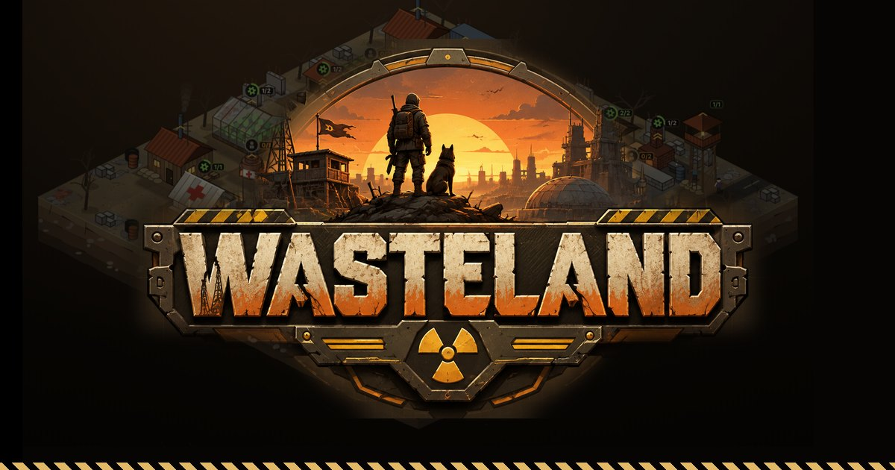
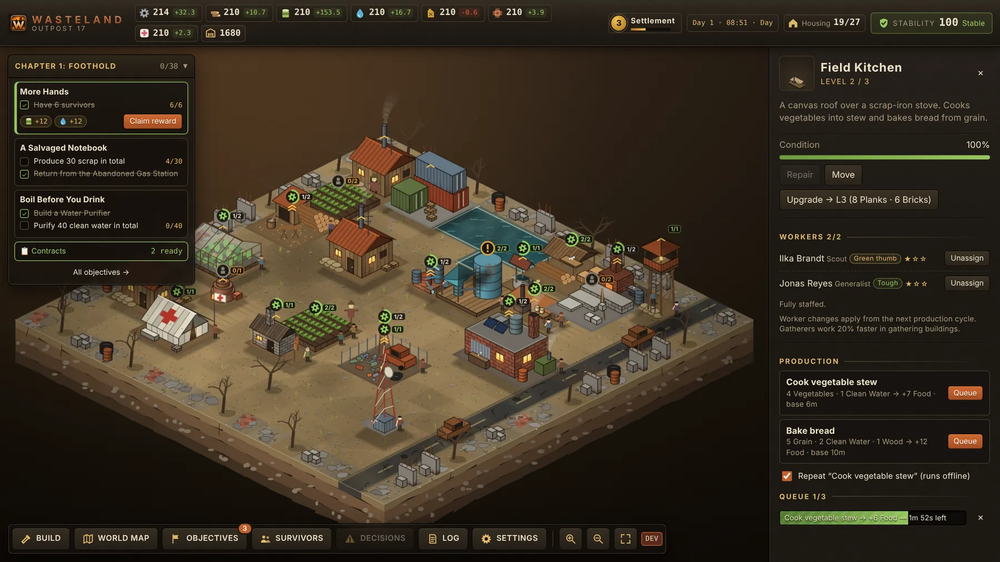
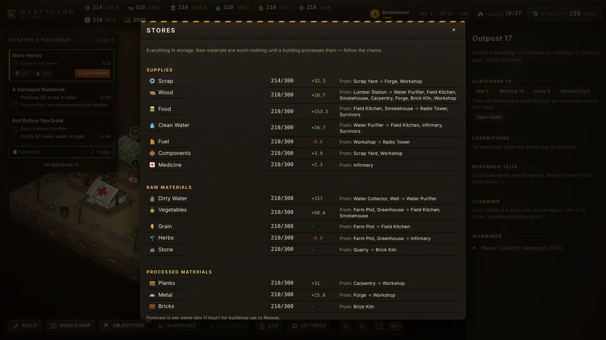
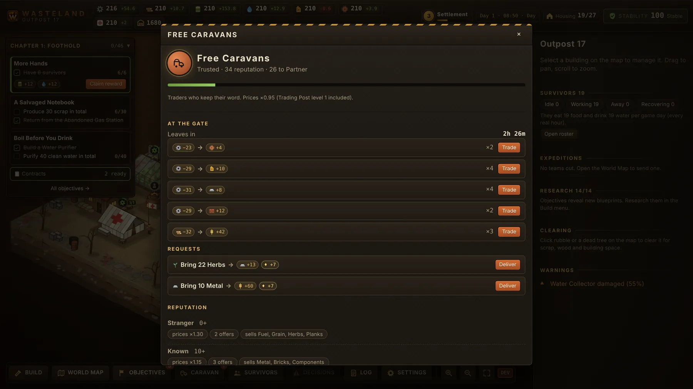
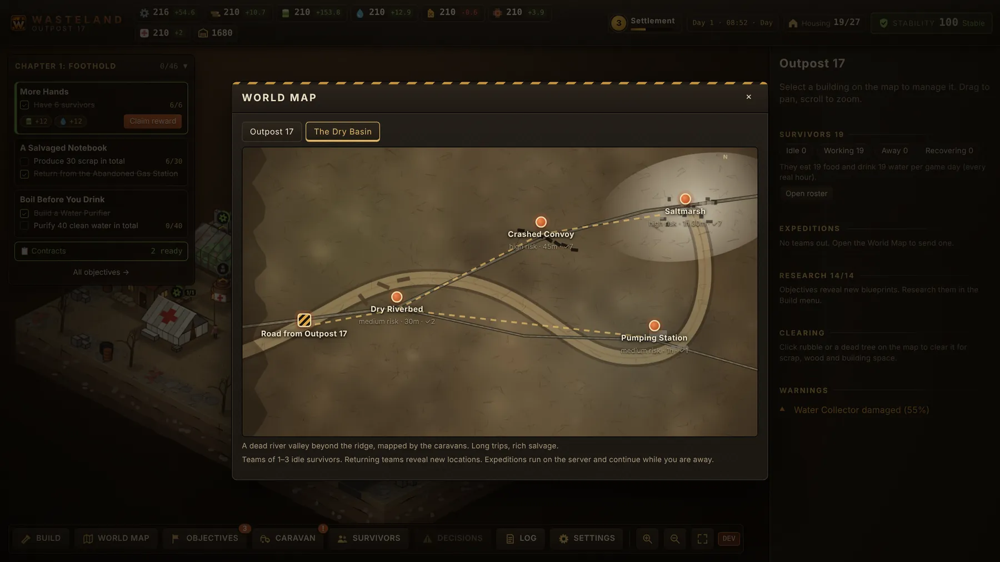
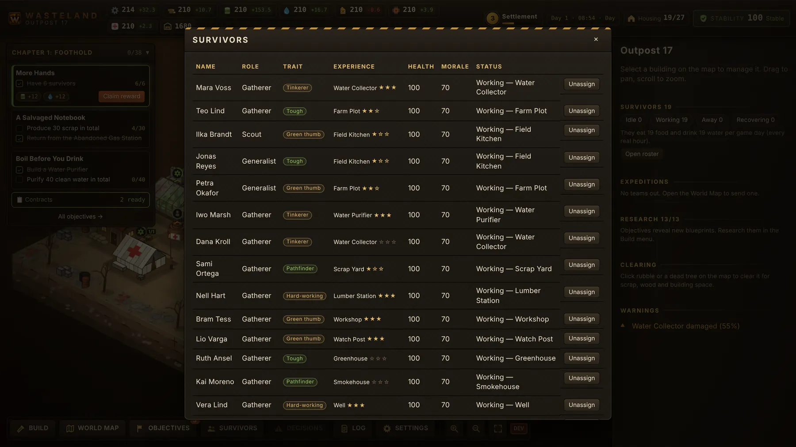
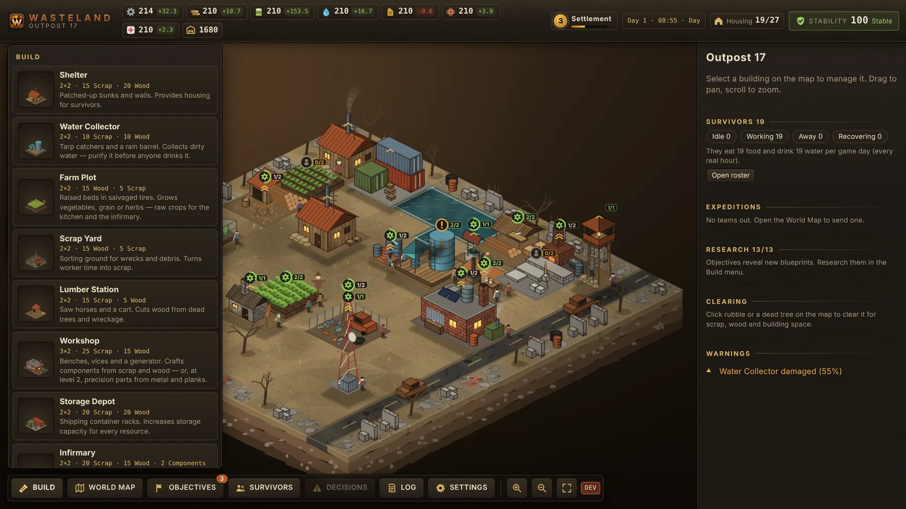
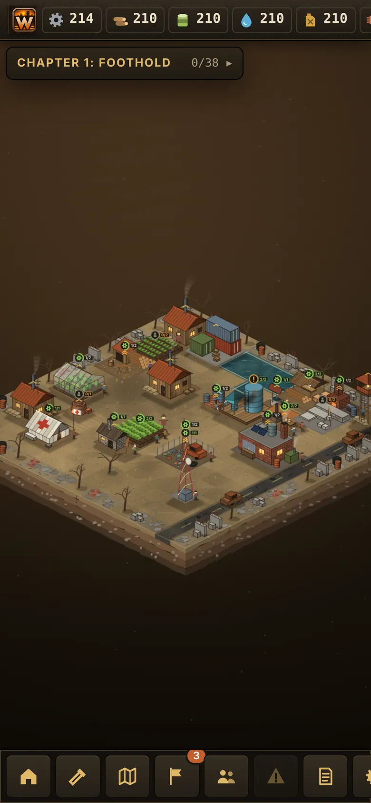

  

<h1 align="center">WASTELAND — Outpost 17</h1>

  <b>A post-apocalyptic, isometric settlement builder for the browser — half active, half idle.</b> 
  <i>Rebuild after the Collapse. Your outpost never sleeps.</i>

  
  
  

  
  
  
  

---

After the Collapse, five survivors hold on to a ruined roadside camp called **Outpost 17** — a shelter, a rain barrel
and a patch of dirt that might still grow something. You decide who works where, what gets built, where the teams go
and what happens when strangers knock at the gate.

Then you close the game — and the outpost keeps working. Farms grow, water gets purified, expeditions return,
research finishes and caravans come and go, all calculated on the server from real time. When you come back,
a report tells you exactly what happened while you were away.

> 🧪 **WASTELAND is in closed development.** Test builds are shared on the **[Discord](https://discord.gg/atxXYTb63Z)**.
> This repository hosts the game's website — the game itself is not open source.

## ✨ What you do

| | |
|---|---|
| 🏗️ **Build & rearrange** | Twenty buildings — shelters, purifiers, farms, a forge, a kiln, a trading post. Upgrade, repair and move them around the map. |
| ⛓️ **Production chains** | Dirty water → purifier → clean water. Vegetables → kitchen → meals. Scrap → forge → metal → workshop. 15 resources in three tiers. |
| 📜 **Blueprints & research** | Most buildings start unknown. Objectives reveal their plans; research takes resources and real time — even while you are away. |
| 🧑‍🤝‍🧑 **Survivors with traits** | Hard-working, Tinkerer, Green thumb, Tough, Pathfinder, Cheerful — and experience from Novice to Master in the work they do. |
| 🗺️ **Expeditions** | Nine locations in two regions, from the gas station to the salt town of the Dry Basin. Loot, injuries, new maps, new people. |
| 🚚 **Free Caravans** | Traders stop at the gate every few hours. Trade, fill their requests and earn reputation for better prices and the maps of new lands. |
| ⚖️ **Hard decisions** | Refugees, fevers, dust storms, supply caches, raiders on the ridge. Anything that can cost you waits for your call. |
| 📈 **Campaign & ranks** | 7 chapters, 46 objectives, a contract board, land clearing and ranks from Camp to Haven. |
| 🎯 **Daily rounds** | 3 short goals every day and 3 bigger ones every week. Progress counts while you are away; unfinished goals simply expire. |

## 🖼️ Screenshots

<table>
  <tr>
    <td></td>
    <td></td>
  </tr>
  <tr>
    <td></td>
    <td></td>
  </tr>
  <tr>
    <td></td>
    <td></td>
  </tr>
</table>

## 🧭 Our rules

- **No punishment for having a life** — being away slows you down, it never destroys what you built.
- **Fair offline progress** — everything is calculated on the server from real timestamps, never from your device's clock.
- **Readable systems** — every number shows why it is what it is.
- **No pay-to-win, no hostile PvP** — now and in the future.

## 🛣️ Roadmap

| ✅ Playable now | 🔜 Next | 🌄 Later |
|---|---|---|
| Building, upgrading and moving | More factions and regions | Late-game projects |
| Production chains, 15 resources | More locations and survivor stories | Accounts, play on any device |
| Survivors with traits and experience | | Mobile app |
| Expeditions, events, contracts, ranks | | Cooperative features — never hostile PvP |
| 7-chapter campaign, blueprints, research | | |
| The Free Caravans and the Dry Basin | | |
| Daily and weekly goals | | |
| Desktop & phone, English & Polish | | |

Every update is described in the public **[update notes](https://github.com/justPLguy/WASTELAND-changelog/releases)**.

## 🔗 Links

- 🌐 **Website:** <https://justplguy.github.io/WASTELAND/>
- 💬 **Discord:** <https://discord.gg/atxXYTb63Z>
- 📜 **Update notes:** <https://github.com/justPLguy/WASTELAND-changelog/releases>

<b>🇵🇱 Po polsku</b>

 

**WASTELAND** to postapokaliptyczny, izometryczny city-builder w przeglądarce — pół aktywny, pół idle.
Po Upadku pięcioro ocalałych trzyma się zrujnowanego przydrożnego obozu zwanego **Placówką 17**. Ty decydujesz,
kto gdzie pracuje, co powstaje, dokąd idą wyprawy i co się dzieje, gdy obcy pukają do bramy.
A gdy zamkniesz grę, placówka pracuje dalej: pola rosną, woda się uzdatnia, wyprawy wracają, badania się kończą,
a karawany przyjeżdżają i odjeżdżają.

Gra jest w zamkniętym rozwoju — wersje testowe trafiają na **[Discorda](https://discord.gg/atxXYTb63Z)**.
Cała gra jest po polsku i po angielsku, działa na komputerze i telefonie, bez pay-to-win.

© 2026 WASTELAND · An independent game in active development — everything you see may still change.

